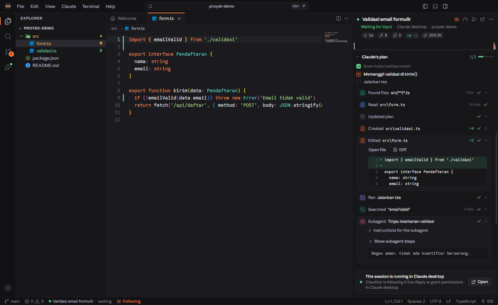

# Clauditor

**A code editor built for Claude Code** — a VS Code–style desktop editor for watching and steering how
Claude builds your project, connected directly to Claude desktop. English by default; Indonesian is
available in Settings → Appearance → Language.

> **Unofficial.** Clauditor is an independent community project. It is not affiliated with, endorsed by,
> or sponsored by Anthropic. Claude, Claude Code and Claude desktop are trademarks of Anthropic, PBC.



## What it does

### Follow Claude live
- **Auto-follow.** Open a project folder; when a Claude desktop session works in it (or in a parent folder
  and starts touching this project), Clauditor follows it right away.
- **Watch Claude type.** The file Claude is editing opens by itself, changes appear as if typed, changed
  lines are highlighted and a "Claude" caret marks the last edit.
- **Session timeline.** Every prompt, answer, thought and tool call (read, edit, command, search, subagent)
  is a card you can open: diffs, command output, file lists.
- **Activity strip.** A seismograph above the timeline shows every step over time (long pauses folded);
  hover for details, click to jump.
- **Claude's plan.** The to-do list (TodoWrite/Task) shows with progress.

### Run Claude Code from Clauditor
- The Claude panel runs the same Claude Code that Claude desktop ships (through Anthropic's Agent SDK).
- Code Claude writes **streams in character by character**.
- **Interactive permissions**: approve or deny edits and commands, answer Claude's questions, approve plans.
- **Models and effort follow Claude**: the model list (with descriptions) and the effort levels each model
  supports are read from Claude Code itself, so new models appear without updating Clauditor.
- Attach images, mention files with `@`, send the editor selection to the message (Ctrl+Alt+L).
- **Send to Claude desktop**: write a prompt in Clauditor and open it as a new Claude desktop session.
- **One-time sign-in.** Claude desktop signs in on its own, so the Claude Code that Clauditor runs needs its
  own login: click **Sign in** in the Claude panel (or Settings → Claude). Clauditor opens
  `claude auth login` in a terminal and you finish in the browser; Clauditor never touches passwords or
  tokens. Following Claude desktop sessions does not need this.

### Connected to Claude desktop
- Reads the state (busy/waiting) and transcript of running sessions live.
- **Open in Claude desktop** for any session (`claude://` deep links).
- Uses the `claude.exe` that comes with Claude desktop — no separate Claude Code install needed.
- **Claude's look**: when Claude desktop is installed, the UI uses the fonts Claude itself uses (Anthropic
  Sans, Serif and Mono), loaded at runtime from the Claude desktop install. Clauditor does not ship those
  fonts; without Claude desktop it falls back to bundled open fonts.

### Keeps up with Claude updates
Everything Clauditor needs from Claude is read from Claude itself and re-read when Claude changes:
- the Claude desktop install (Microsoft Store/MSIX or classic installer) and its version;
- the newest Claude Code that Claude desktop drops in (watched on disk, so an update is picked up while
  Clauditor runs — with a notice);
- fonts (their file names change with each Claude release);
- models and effort levels;
- the **Agent SDK**: Anthropic's SDK is not redistributed with Clauditor. On first use, Clauditor fetches the
  release made for your Claude Code version from the npm registry (integrity-checked), and again whenever
  Claude desktop brings a newer Claude Code. Updates can be turned off in Settings → Claude.

Settings → Claude shows what is in use (Claude desktop, Claude Code, SDK, fonts, models) with a
**Check now** button.

### Claude Code IDE bridge
Clauditor runs the same IDE protocol server as the VS Code extension. A Claude Code CLI started from a
Clauditor terminal (the **Claude Code** profile) connects automatically, so Claude can:
- show proposed changes as diffs in Clauditor for you to **Accept/Reject**,
- read the selection, open files, and the editor's diagnostics (errors/warnings).

### History and analysis
- **Replay**: a step-by-step reconstruction of how each file was built in a session.
- **Session overview**: duration, tools, files changed, lines +/−, tokens, an activity chart and per-file
  diffs (before the session ↔ now, using Claude's file-history backups).

### A complete editor
Monaco (VS Code's editor engine) with tabs, preview, split, breadcrumbs, minimap, TS/JS IntelliSense,
explorer (create/rename/delete to Recycle Bin), ripgrep search + replace, Git (stage, commit, branches,
push/pull, commit messages drafted by Claude), xterm.js + ConPTY terminals, command palette, dark/light
themes with five accent colors, and auto save that is safe against Claude's own edits.

## Requirements

- Windows 10 (1809) or Windows 11, x64
- [Claude desktop](https://claude.ai/download) installed and signed in
- An internet connection the first time you run Claude from Clauditor (to fetch the Agent SDK)

## Install

Download `Clauditor-Setup-<version>.exe` from the
[latest release](https://github.com/rivaldis159/clauditor/releases/latest) and run it — a per-user
install, no administrator rights needed. It creates Desktop and Start menu shortcuts, adds
**Open with Clauditor** to the Explorer folder menu (Windows 11: "Show more options"), and registers in
Settings → Apps for uninstalling.

The installer is not code-signed, so Windows SmartScreen may say *"Windows protected your PC"*: choose
**More info → Run anyway**. You can check the download against the SHA-256 listed in the release notes.

The app installs to `%LOCALAPPDATA%\Programs\Clauditor`; settings live in `%APPDATA%\Clauditor`.
Open a folder from the command line: `Clauditor.exe "D:\my\project"`.

## Key shortcuts

| Shortcut | Action |
|---|---|
| Ctrl+P | Quick open (`>` commands, `:` line, `#` Claude sessions) |
| Ctrl+Shift+P | Command palette |
| Ctrl+L | Message Claude |
| Ctrl+Alt+F | Follow mode on/off |
| Ctrl+Alt+L | Add selection to the Claude message |
| Ctrl+Alt+K | Send selection to Claude Code CLI (IDE) |
| Ctrl+` | Terminal |
| Ctrl+B / Ctrl+J / Ctrl+Alt+B | Sidebar / panel / Claude panel |

## Build from source

Needs Node.js 22.12+ and, for the installer, [Inno Setup 6](https://jrsoftware.org/isdl.php).

```bash
npm install
npm run dev        # development mode (HMR)
npm test           # unit tests (Vitest)
npm run e2e        # end-to-end tests (Playwright + Electron); TOUR=1 [TOUR_LANG=id] for the screenshot tour
npm run typecheck  # TypeScript 7
npm run i18n       # every UI string has an Indonesian translation, no hard-coded text
npm run icons      # rebuild build/icon.ico, build/icon.png, resources/icon.png from build/icon.svg
npm run dist       # dist/win-unpacked (electron-builder) + dist/Clauditor-Setup-<version>.exe (Inno Setup)
```

`npm install` also installs `@anthropic-ai/claude-agent-sdk` as a development dependency; its use is
subject to [Anthropic's terms](https://code.claude.com/docs/en/legal-and-compliance). It is used in
development only and is not packaged into the app.

Architecture:
- `src/main` — Electron main process: files & watcher, ripgrep, node-pty, git, Claude transcript reader
  (`services/claude`), Agent SDK runner and SDK download/sync (`sdk.ts`), Claude desktop detection
  (`environment.ts`), IDE bridge (WebSocket MCP).
- `src/preload` — typed IPC bridge (`src/shared/ipc.ts`).
- `src/renderer` — React 19 + Zustand + Monaco + xterm.js; styles in `src/renderer/src/styles`.
- `src/shared` — types, default settings, line-diff algorithm, replay reconstruction, translations
  (`i18n/`: English source strings in code, Indonesian dictionary per area in `i18n/id/`).

Claude data is read from `~/.claude` (transcripts in `projects/`, live state in `sessions/`, backups in
`file-history/`). Clauditor only reads that data; the one thing it writes there is the IDE bridge lock file
in `~/.claude/ide/`, removed again when Clauditor closes. Sessions run from the Claude panel are written by
Claude Code itself, like any CLI session.

When Clauditor is started from inside a Claude Code session (e.g. a Claude desktop terminal), that
session's environment variables (`CLAUDECODE`, `CLAUDE_CODE_*`, …) are dropped at start so the Claude Code
that Clauditor runs stands on its own.

## License

Clauditor's own code is released under the [MIT License](LICENSE). Bundled third-party components keep
their own licenses — see [THIRD-PARTY-NOTICES.md](THIRD-PARTY-NOTICES.md). Anthropic's Agent SDK, Claude
Code and Claude's fonts are not part of this repository or the installer; they come from Anthropic (npm and
the Claude desktop app) under Anthropic's terms.
